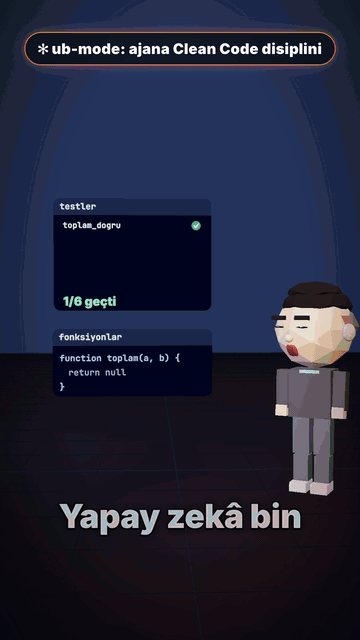
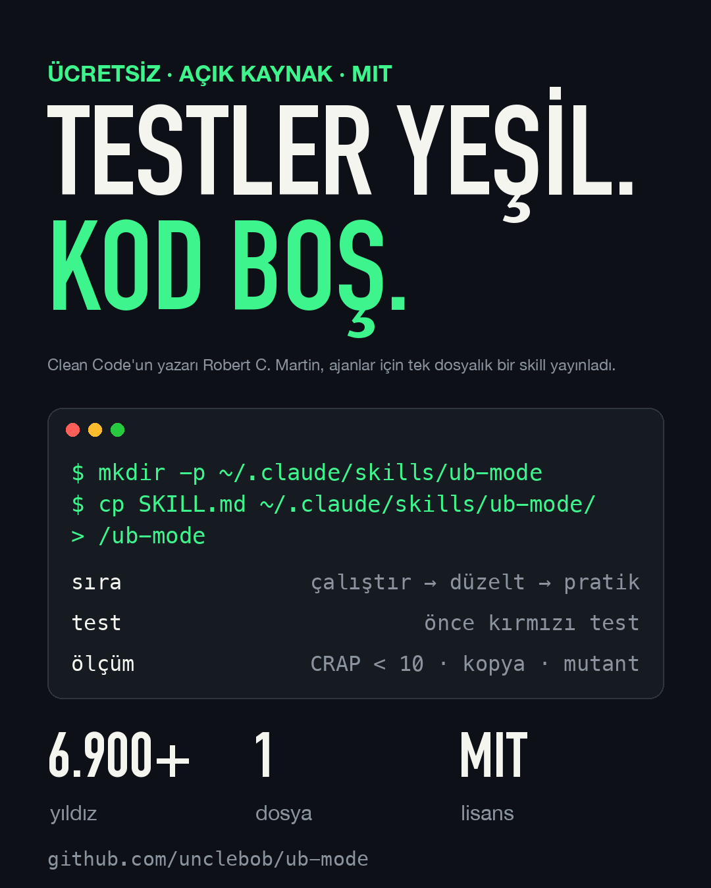

# Testler yeşil yandı. Fonksiyonlar boş dönse bile yine geçiyordu.

6.900+ yıldız. Tek dosya. Yazarı Robert C. Martin.

ub-mode.

Clean Code kitabının yazarı, kodlama ajanları için bir skill yayınladı. Kural sırası:
→ First Make it Work: önce başarısız testi yaz, doğru sebeple kırıldığını gör
→ "Her fonksiyon hiçbir şey döndürse de geçecek test" çöpe
→ hatanın sebebini düzelt; çökmeyi saklayan koruma satırı düzeltme sayılmaz
→ Then Make it Right: crapper ile her fonksiyon CRAP < 10
→ dryer ile benzer kopyaları bul, mutator ile testlerin kaçırdığı değişiklikleri yakala
→ araçlar Python, Java, Go, TypeScript, Rust ve Clojure okuyor
→ Practice: küçük, sıralı commit; her commit neden + ne + nasıl kanıtlandı

Kurulum:
mkdir -p ~/.claude/skills/ub-mode
cp SKILL.md ~/.claude/skills/ub-mode/
Sohbette: /ub-mode

**📊 Rakamlarla:**
• 6.900+ yıldız
• 1 dosya
• MIT lisans

**⚙️ Nasıl başlarsın:**
$ mkdir -p ~/.claude/skills/ub-mode
$ cp SKILL.md ~/.claude/skills/ub-mode/
> /ub-mode

**📌 Kısa notlar:**
• sıra: çalıştır → düzelt → pratik
• test: önce kırmızı test
• ölçüm: CRAP < 10 · kopya · mutant

**✨ Öne çıkanlar:**
• önce çalıştır, sonra düzelt, sonra pratik
• boş dönse de geçen test çöpe
• crapper · dryer · mutator: 6 dil

Ajanınız kod yazmadan önce test yazıyor mu?

[▶ Tam kalite video: video.mp4](video.mp4)

## Videoda adım adım

1. Clean Code kitabının yazarı Robert Martin, ajanlar için ub-mode adında ücretsiz bir skill yayınladı.
2. Önce çalıştır, sonra düzelt diyor ve koda dokunmadan önce kırmızı yanan bir test istiyor.
3. Fonksiyonlar boş dönse bile geçecek testi çöpe attırıyor, yerine kullanıcının gördüğü sonucu ölçen test yazdırıyor.
4. Ardından üç ölçüm aracı devreye giriyor, üçü de Robert Martin'in kendi deposunda.
5. Crapper karmaşıklığı test kapsamıyla birleştirip her fonksiyonun puanını 10'dan aşağı çekiyor.
6. Dryer %80 benzeyen kopyaları buluyor, mutator ise testlerin kaçırdığı değişiklikleri yakalıyor.
7. Araçlar Python, Java, Go, TypeScript, Rust ve Clojure okuyor, ilk koşuda kendi ortamını kuruyor.
8. Kurmak için tek dosyayı skills klasörüne kopyalıyorsun ve sohbette /ub-mode yazıyorsun.

## Kaynak

- https://github.com/unclebob/ub-mode

## Lisans

Bu depodaki video, kart ve metinler MIT lisanslıdır (LICENSE). Anlatılan aracın kendi lisansı kendi deposundadır.
